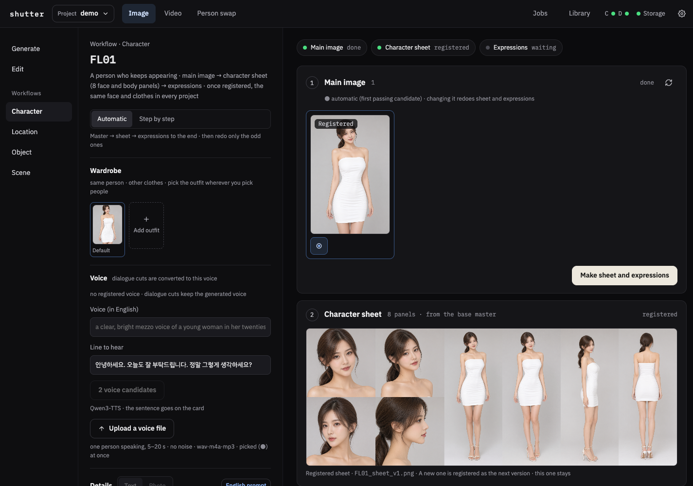

# shutter

**Long-form AI video production on NVIDIA GB10 (DGX Spark class) — from characters to a finished, continuous film.**
Its own CUDA engine gives the same output as ComfyUI with the same models, faster. One node is enough; every extra node
takes a share of the work.

## Why shutter

- **Built for long videos.** A film is made shot by shot and then joined into one continuous video (one encode, sound
  carried across shots, episode breaks optional). See *How two nodes share the work* below.
  - A ~3-minute drama from a script (characters already registered) — 70 first frames, 80 video cuts, 40 voiced
    lines — in **99 minutes on two nodes**, no failures (measured).
  - Person swap on a 29 s dance video: 7 segments with outfit and shoes held the whole way, face fix and 1080p upscale
    included, 91 minutes on two nodes (measured).
- **Faster than ComfyUI, same output.** Same GB10, same models and settings; outputs checked against ComfyUI on fixed
  tests (same videos; SeedVR2 end to end 54.8 dB PSNR).

  | job | shutter | ComfyUI |
  |---|---|---|
  | pi-H3 cut, 7.3 s, 2 steps | **110 s** | 148–154 s |
  | pi-H3 text-to-video, 10 s, 4 steps | **328 s** | 404 s |
  | LTX-2.5 cut, 5 s, 1088×1920 | **134 s** | 201 s |
  | LTX-2.5 with IC-LoRA | **128 s** | 217 s |
  | SeedVR2 7B upscale, 5 s → 1080p | **270 s** | ≈447 s |

- **One node runs everything; more nodes go faster.** Each shot is made by one GPU, so a single GB10 can do every job.
  Add a second node and shutter hands out the work by itself — nothing to configure per job. ComfyUI runs on one
  machine at a time.
- **Characters stay the same person.** Main image → 8-panel reference sheet (4 faces, 4 full body) → expressions, every
  image face-checked; video cuts get a face pass (hyperswap with an occlusion mask) so faces don't drift between cuts.
  A wardrobe keeps the same person in other outfits.
- **Script to film.** A plain-text script (scenes, cuts, first frames, dialogue, screen text) drives the whole chain:
  first frames → video cuts → voices → scene export → one film. Screen text (name cards, counters, live comments,
  subtitles) stays sharp after upscaling, and every character keeps one voice (voice conversion that keeps the length,
  so lips stay in sync).
- **Fetch only what you use.** Models come in groups: images and characters need 25 GB; add video, upscale or voice
  when you need them. Every file is pinned to the exact version shutter was tested with and sha256-checked, and the
  folder can be shared with ComfyUI — no copies.
- **Simple to run.** One Docker image; a browser UI in English or Korean, run from your own computer (macOS, Linux or
  Windows with WSL) and saving your work there. The queue lives on the node, so jobs keep running while your laptop sleeps.

## How two nodes share the work

Think of each node as one camera crew. shutter keeps a to-do list on the main node; whenever a node is free it takes the
next item.

- **A film is made of shots, so the shots are shared.** A 20-second video made of two 10-second shots: with one node
  the shots are made one after the other (about 11 minutes with pi-H3, 4 steps); with two nodes both are made at the
  same time (about 5.5 minutes), then joined. More shots, same idea — two nodes take about half the time
  (estimate from the measured 328 s per 10 s shot).
- **One continuous shot stays on one node.** A single unbroken shot is made whole by one node — splitting it would
  break the motion. Meanwhile the other node works on the next shot.
- **A long source video is cut into pieces.** For person swap and upscaling, the input video already exists, so it is
  cut into ~5-second pieces that the nodes work on side by side. The joins don't show: for a swap the frames where
  pieces meet are made first and shared by both pieces; for upscaling the pieces overlap and are blended.

Measured on two nodes: six pi-H3 shots (4 steps + face fix) in 11 minutes; a 59.6 s film upscaled in 29 minutes (≈52 on
one node, estimate).




## How it works

- One Docker image. The main node runs the job queue server and a worker; every other node runs a worker.
- Models: Qwen-Image 2.1 (images, characters, scenes), MiniMax H3 (reference-to-video and person swap with
  Singularity v1.3 + turbo LoRA; pi-H3 2/4-step for drama shots), LTX-2.5 (image-to-video), SeedVR2 7B (upscale),
  Qwen3-TTS + Seed-VC (voices).
- Weights live in one folder in ComfyUI's layout (`diffusion_models/`, `text_encoders/`, `vae/`, `loras/` …),
  mounted read-only. LoRAs and the pi-H3 adapter are merged at load exactly as ComfyUI computes them, so the folder
  holds only the original files.

## Requirements

- **GPU nodes**: one or more NVIDIA GB10 (sm_121) machines with Docker and GPU access (`docker run --gpus all`), reachable
  by SSH. Disk for the weights: 25 GB for images and characters, up to 149 GB for everything (see Weights below).
- **Your computer** (where you work in the browser and where your work is kept): macOS, Linux or Windows with WSL, with
  Python 3.9+, curl and a browser. macOS needs nothing else. On Linux / WSL add Pillow and PyAV inside the project
  folder (for crops and thumbnails): `python3 -m venv .venv && .venv/bin/pip install pillow av`.

Your images, videos and originals stay in a folder you choose on your computer. The nodes only hold working copies:
a result is removed from the node once your computer has it, and inputs are cached for 3 days (Settings › Keep (days);
0 removes them at the next clean-up once no job needs them).

## Setup

Everything is run from your computer. The nodes need no copy of this repository — step 3 makes each of them build the
image from GitHub by itself.

1. **Your computer — get the code.**
   ```bash
   git clone <this repository's URL> shutter && cd shutter
   python3 -m venv .venv && .venv/bin/pip install pillow av     # Linux / WSL only
   ```
2. **Your computer — settings.**
   ```bash
   cp shutter.conf.example shutter.conf             # your nodes (one is fine), SSH access, folders, REPO = this repository
   cp mac/settings.example.json mac/settings.json   # server = http://<main node>:8300, storage = the folder for your work
   ```
3. **Your computer — build on the nodes.** `./deploy.sh build 1.1`: every node fetches tag 1.1 from GitHub and builds
   the image `shutter:1.1` (the first build compiles the engine and takes a while).
4. **Each node — fetch the weights**, only the groups you need (next section).
5. **Your computer — start.** `./start.sh` starts the node containers and the UI; open http://127.0.0.1:8310.
   `./stop.sh` stops the nodes first (a running unit goes back to the queue), then the UI.

### Weights

Each node needs the weights in one models folder (ComfyUI's folder layout; a ComfyUI install can share it).
`fetch_models.py` downloads them from their original Hugging Face repositories, pinned to the exact files shutter was
tested with (`docker/weights.lock.json`: repo commit, size, sha256). Every download is checked; files already in the
folder are kept. **You don't need everything** — fetch the groups for what you make:

| you make | groups | download |
|---|---|---|
| images, characters, places, scenes | `image` | 25 GB |
| + drama cuts with pi-H3 / reference video with H3 | `image h3` | 93 GB |
| + drama cuts with LTX-2.5 | `image ltx` | 65 GB |
| + upscale to 1080p | add `upscale` | +8.8 GB |
| + character voices | add `voice` | +6.9 GB |
| everything | (no group) | 149 GB |

Groups in detail (`base` comes with every group):

| group | size | needed for |
|---|---|---|
| base | 0.8 GB | face check, face pass, pose check — always fetched |
| image | 24.5 GB | images, characters, places, scenes (Qwen-Image 2.1); also person swap |
| h3 | 68.1 GB | `video.r2v`, `video.swap`, `video.pih3` (MiniMax H3, pi-H3) |
| ltx | 39.7 GB | `video.i2v` (LTX-2.5) |
| upscale | 8.8 GB | `video.upscale` (SeedVR2 7B) |
| voice | 6.9 GB | `audio.tts`, `audio.voice` |

```bash
F="docker run --rm --user 1000:1000 -e HOME=/tmp -v $HOME/studio/models:/models shutter:1.1 python /opt/shutter/fetch_models.py"
$F --list            # groups, sizes, what is already there
$F image             # start small: images and characters only (base comes with it)
$F                   # everything
```

- LTX-2.5 is gated: sign in on Hugging Face, accept the license on the
  [LTX-2.5 page](https://huggingface.co/Lightricks/LTX-2.5), create a read token and add `-e HF_TOKEN=hf_...` to the
  `docker run` line. The other repositories need no token.
- More nodes: copy the folder from the first node instead of downloading again
  (`rsync -a ~/studio/models/ <node>:~/studio/models/`), then run `$F --verify` there — it checks every file's sha256
  (a few minutes for all of it).
- A file that is already there with another size (another version under the same name, e.g. from ComfyUI) is reported
  and left alone; move it aside and run again to fetch the tested one.

`./deploy.sh logs` shows the container logs; `./deploy.sh up | down` restarts or stops only the nodes.

Job types and their options are documented in `server/server.py` (`TYPES`); the UI calls the same HTTP API
(`POST /jobs`, `GET /jobs`, `GET /queue`).

## License

Apache-2.0 (`LICENSE`). The Pretendard fonts in `engine/fonts/` are under the SIL Open Font License
(`engine/fonts/Pretendard-LICENSE.txt`). Seed-VC (GPL-3.0) is not part of this repository: the image build fetches it
(`docker/Dockerfile`). Model weights keep their own licenses (`engine/py/models.py` lists their sources).
