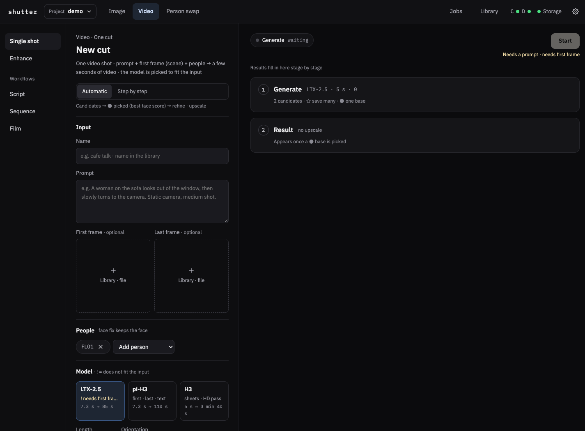

# shutter

An image and video production server for NVIDIA GB10 nodes (DGX Spark class), with its own CUDA engine. Jobs are
characters (Qwen-Image 2.1 masters, 8-panel sheets, face check), scenes, reference-to-video and person swap
(MiniMax H3: Singularity v1.3 + turbo LoRA), drama shots (LTX-2.5 image-to-video with a face pass, pi-H3 2/4-step) and
upscaling (SeedVR2 7B). With the same models it gives the same results as ComfyUI, faster.

- One Docker image. The main node runs the job queue server and a worker; every other node runs a worker. Long videos
  are split into segments that the nodes generate in parallel.
- Weights live in one shared folder in ComfyUI's folder layout (`diffusion_models/`, `text_encoders/`, `vae/`,
  `loras/` …), mounted read-only. LoRAs and the pi-H3 adapter are merged at load exactly as ComfyUI computes them, so the
  folder holds only the original files and a ComfyUI install can use the same folder.
- A small web UI (`mac/mac.py`, Python standard library only) submits jobs, shows the queue and saves results to a
  local folder.




## Requirements

- NVIDIA GB10 (sm_121) nodes with Docker and GPU access (`docker run --gpus all`), the base image
  `nvcr.io/nvidia/pytorch:26.07-py3`
- Disk for the weights: about 149 GB for everything, less if you fetch only the groups you use (see Weights below)

## Setup

```bash
cp shutter.conf.example shutter.conf          # nodes, how to reach them, data and models folders, image TAG
cp mac/settings.example.json mac/settings.json   # server = http://<main node>:8300, storage = where results go
./deploy.sh build 1.1                         # every node builds shutter:1.1 from this repository (REPO in shutter.conf)
```

### Weights

Each node needs the weights in one models folder (ComfyUI's folder layout; a ComfyUI install can share it).
`fetch_models.py` downloads them from their original Hugging Face repositories, pinned to the exact files shutter was
tested with (`docker/weights.lock.json`: repo commit, size, sha256). Every download is checked; files already in the
folder are kept.

| group | size | needed for |
|---|---|---|
| base | 0.8 GB | face check, face pass, pose check — always fetched |
| image | 24.5 GB | images, characters, places, scenes (Qwen-Image 2.1); also person swap |
| h3 | 68.1 GB | `video.r2v`, `video.swap`, `video.pih3` (MiniMax H3, pi-H3) |
| ltx | 39.7 GB | `video.i2v` (LTX-2.5) |
| upscale | 8.8 GB | `video.upscale` (SeedVR2 7B) |
| voice | 6.9 GB | `audio.tts`, `audio.voice` |

```bash
F="docker run --rm --user 1000:1000 -e HOME=/tmp -v $HOME/studio/models:/models shutter:1.1 python /opt/shutter/fetch_models.py"
$F --list            # groups, sizes, what is already there
$F image             # start small: images and characters only (base comes with it)
$F                   # everything
```

- LTX-2.5 is gated: sign in on Hugging Face, accept the license on the
  [LTX-2.5 page](https://huggingface.co/Lightricks/LTX-2.5), create a read token and add `-e HF_TOKEN=hf_...` to the
  `docker run` line. The other repositories need no token.
- More nodes: copy the folder from the first node instead of downloading again
  (`rsync -a ~/studio/models/ <node>:~/studio/models/`), then run `$F --verify` there — it checks every file's sha256
  (a few minutes for all of it).
- A file that is already there with another size (another version under the same name, e.g. from ComfyUI) is reported
  and left alone; move it aside and run again to fetch the tested one.

Then, on the machine you work from:

```bash
./start.sh      # node containers (main node: server + worker, others: worker) and the UI, http://127.0.0.1:8310
./stop.sh       # nodes first (a running unit goes back to the queue), then the UI
```

`./deploy.sh logs` shows the container logs; `./deploy.sh up | down` restarts or stops only the nodes.

Job types and their options are documented in `server/server.py` (`TYPES`); the UI calls the same HTTP API
(`POST /jobs`, `GET /jobs`, `GET /queue`).

## License

Apache-2.0 (`LICENSE`). The Pretendard fonts in `engine/fonts/` are under the SIL Open Font License
(`engine/fonts/Pretendard-LICENSE.txt`). Seed-VC (GPL-3.0) is not part of this repository: the image build fetches it
(`docker/Dockerfile`). Model weights keep their own licenses (`engine/py/models.py` lists their sources).
